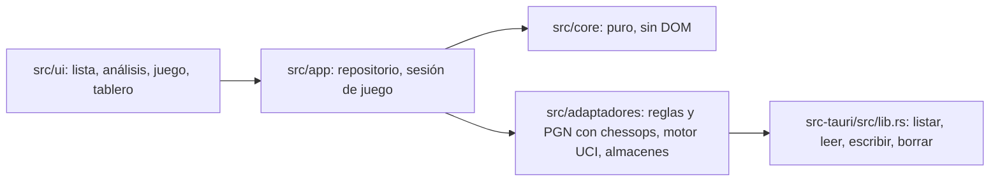

# Ajedrez

App personal para jugar contra Stockfish y analizar partidas a mano, con ramas y comentarios, sin que un motor marque errores. Las partidas son archivos PGN en una carpeta que sincroniza Syncthing.

## Qué hace (PC, Fases 2 y 3)
- **Lista** de partidas con filtro (victoria, derrota, tablas, en curso), avisa si Syncthing dejó copias en conflicto.
- **Importar**: pegar uno o varios PGN (chess.com, Lichess) o elegir archivos `.pgn`/`.txt`. Quita `[%eval]` y los comentarios "Mistake… was best", conserva relojes y comentarios, y saltea repetidas (por `GameId` o por huella de las jugadas).
- **Análisis** sin motor: recorrer con ←/→/Inicio/Fin, hacer jugadas nuevas (quedan como ramas), comentar, hacer línea principal, borrar desde una jugada. Guarda tras cada cambio.
- **Jugar** contra Stockfish lite (5 niveles), con reloj e incremento, pista en dos pasos (pieza, después jugada), deshacer, tablas y rendirse. Guarda tras cada jugada con `[EnCurso "1"]`; tocar una partida en curso la retoma.

## Requisitos
Node 22, Rust (rustup) y en Debian `libwebkit2gtk-4.1-dev libssl-dev librsvg2-dev build-essential`.

## Comandos
```bash
npm install
npm run verificar      # tsc + todos los tests (visibles y ocultos)
npx tauri dev          # la app de escritorio, con recarga
npx tauri build        # binario en src-tauri/target/release/ajedrez y paquetes .deb/.AppImage
npm run dev            # solo navegador: las partidas quedan en memoria y se pierden al cerrar
```

## Dónde guarda los datos
`~/Documentos/Carpeta personal/Ajedrez/Partidas/`, un `.pgn` por partida (`AAAA-MM-DD_HHMMSS_blancas-vs-negras_<id8>.pgn`). Escritura atómica (`.tmp` y renombrar). No hay índice en disco: se rearma al abrir.

## Estructura

`src/core/` lo escribieron qwen y Gemma (ver `docs/llm/README.md`). Tests de adaptadores, repositorio, motor y sesión en `tests-ocultos/`. Spikes en `spikes/` (`s2.html` se abre con `npm run dev` en `/spikes/s2.html`).

## Licencia
Usa chessground y Stockfish (GPL-3.0): si se publica, el código tiene que ser GPL.
